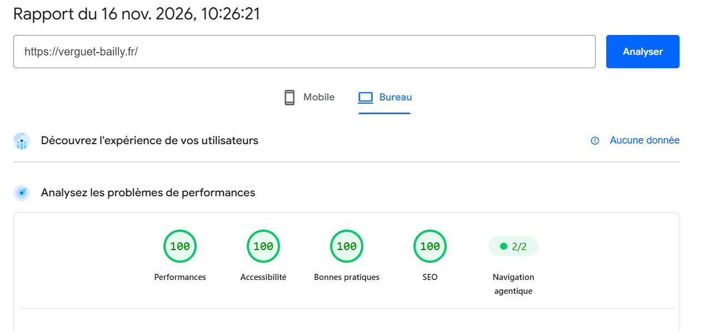
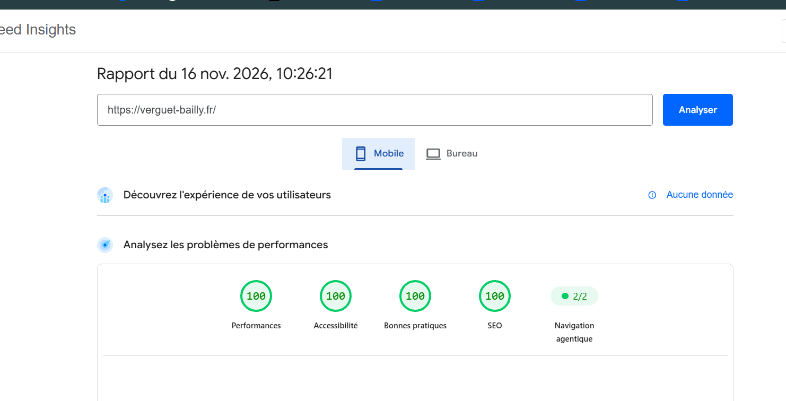

# Démarche qualité

Ce que j'ai mis en place pour que le portfolio soit accessible, rapide, bien référencé, sûr et
conforme à la loi, et comment je l'ai vérifié.
Vérifications faites sur le site en ligne (https://verguet-bailly.fr) le 16/11/2026.

## Score Lighthouse (PageSpeed Insights, 16/11/2026)

100 partout, sur mobile comme sur ordinateur :

- Performances : 100
- Accessibilité : 100
- Bonnes pratiques : 100
- SEO : 100

Bureau :

Mobile :

## 1. Accessibilité

- **Langue** : `<html lang="fr">` sur toutes les pages.
- **Titres** : un seul `<h1>` par page, puis `<h2>` et `<h3>` dans l'ordre (7 pages vérifiées).
- **Images** : toutes ont un `alt`.
  Il est descriptif pour les images de contenu, et vide pour les visuels des cartes,
  car le titre du projet est déjà dans le lien.
- **Clavier** : le focus est bien visible (contour bleu de 3 px).
  Les cartes s'animent aussi quand on les atteint au clavier.
- **Zones cliquables** : au moins 44 px de haut pour les boutons et les liens importants.
- **Formulaire** : chaque champ a son `<label>`, les champs obligatoires sont marqués `required`,
  et le message de confirmation ou d'erreur est lu par les lecteurs d'écran (`aria-live`).
- **Image agrandie** : balise `<dialog>` du navigateur (fond sombre, focus bloqué dans la fenêtre, fermeture avec Échap).
- **Animations** : si le réglage système « réduire les animations » est activé, toutes les animations sont coupées.
- **Contrastes** (norme WCAG, minimum 4,5:1, AAA à partir de 7:1) :
  - texte noir `#111111` sur le fond gris `#e3e3e3` : 14,7:1 (AAA) ;
  - texte blanc sur le bleu `#0533ff` : 7,2:1 (AAA).

## 2. Performance et éco-conception

- **Site statique** : les pages sont fabriquées une seule fois, au build ; le visiteur reçoit
  du HTML déjà prêt, sans serveur ni base de données à interroger.
- **Poids des pages** : de 26 à 63 Ko de HTML par page.
- **Images** :
  - converties en WebP et à la bonne taille par Astro, au build ;
  - chargées seulement quand on s'en approche en faisant défiler (`loading="lazy"`).
- **Cache du navigateur** : les images et les fichiers CSS/JS (`/_astro/`) sont gardés un an (`netlify.toml`).
- **JavaScript** : 
  - L'accordéon des compétences utilise `
`, sans JS.
  - Les transitions entre les pages sont faites par le navigateur, en CSS.
  - Le JS ne sert qu'au formulaire, à l'image agrandie et au sens des transitions.
- **Polices** : hébergées sur le site, sans appel à Google Fonts.
- **Vidéo** : WebM transparent (1,2 Mo), avec un MP4 pour Safari.

## 3. Référencement (SEO) et partage

- **Titre et description** propres à chaque page et à chaque projet.
- **Adresse canonique** sur chaque page (`<link rel="canonical">`).
- **Sitemap** : `/sitemap.xml`, généré automatiquement avec tous les projets (10 adresses).
- **robots.txt** : autorise tout et indique où est le sitemap.
- **Page 404** : vraie erreur 404 pour une adresse inconnue, y compris pour un projet qui n'existe pas.
- **Partage sur les réseaux** : balises Open Graph, et une image de partage générée pour chaque projet (`/og/<projet>.png`).
- **HTTPS** : certificat Let's Encrypt créé par Netlify ; `http://` est redirigé vers `https://`.

## 4. Sécurité

- **Site statique** : pas de serveur applicatif ni de base de données en ligne, donc beaucoup moins
  de points d'attaque possibles.
- **En-têtes HTTP** (`netlify.toml`) :
  - `X-Frame-Options: DENY` : le site ne peut pas être affiché dans une iframe ;
  - `X-Content-Type-Options`, `Referrer-Policy`, `Permissions-Policy`.
- **Formulaire** (Netlify Forms) :
  - le navigateur vérifie les champs (obligatoires, email valide, longueurs) ;
  - un champ invisible piège les robots (« honeypot »), et Netlify filtre aussi le spam ;
  - les messages ne sont lisibles que par moi, dans Netlify et par email.
- **Fichiers sensibles** : `.env` et l'ancienne base locale (`pocketbase/pb_data/`) ne sont pas envoyés sur GitHub (`.gitignore`).

## 5. Aspects légaux (LCEN, RGPD)

- Page **Mentions légales** : éditeur, hébergeur, propriété intellectuelle, crédits (`/mentions-legales`).
- Les projets étudiants sont présentés comme des exercices pédagogiques ;
  les marques de tiers (La Cimade, FCSM…) restent à leurs détenteurs.
- **Données personnelles** : le formulaire indique à quoi servent les données,
  combien de temps elles sont gardées (12 mois) et renvoie vers les droits RGPD.
- **Aucun cookie** ni outil de mesure d'audience : pas besoin de bandeau de consentement.

## 6. Code et maintenance

- **Composants Astro** réutilisables (header, footer, cartes, sections de projet).
- **Charte graphique** déclarée à un seul endroit : `src/styles/global.css`.
- **Contenu séparé du code** : les projets sont dans `src/data/projets.json` et leurs images dans
  `src/assets/projets/` ; une page par projet est générée automatiquement.
- **Tout est versionné** dans Git : contenu, images et code.
- **Code commenté** en français ; le `README.md` explique comment lancer, construire et déployer le site.
- **Déploiement automatique** : Netlify reconstruit et publie le site à chaque push ;
  si le build échoue, l'ancienne version reste en ligne.

## 7. Compatibilité

- Testé sur ordinateur (1440 px) et sur mobile (390 px).
- Testé par moi sur mon téléphone et sur un autre navigateur.
- Formulaire de contact : à retester en ligne avec un vrai message depuis le passage sur Netlify Forms.
- Transitions entre les pages : Chrome, Edge et Safari récent.
- Firefox affiche les pages normalement, sans animation.

## 8. Limites connues

- Ajouter ou modifier un projet demande de modifier `projets.json` et de pousser sur GitHub
  (il n'y a plus d'interface d'administration comme avec PocketBase).
- Le formulaire dépend de Netlify Forms (100 messages par mois sur l'offre gratuite).
